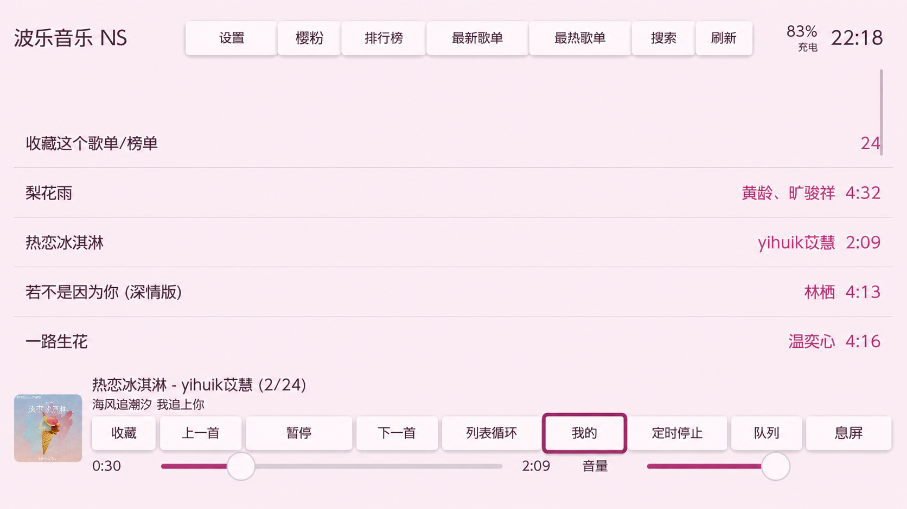
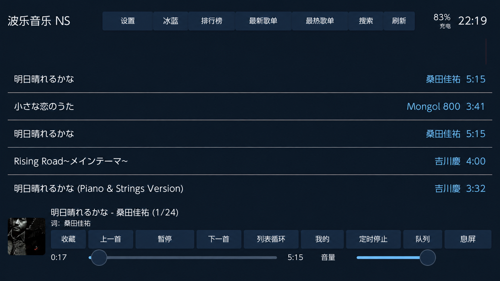
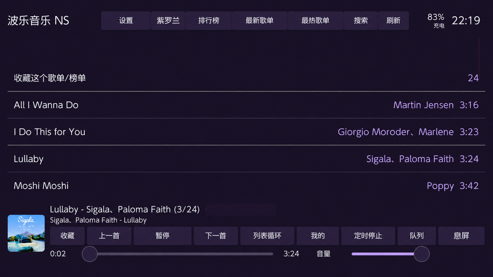
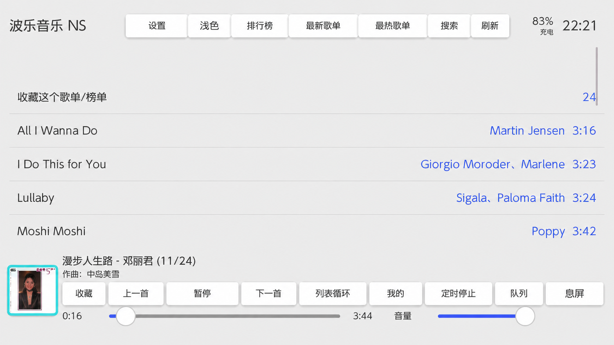
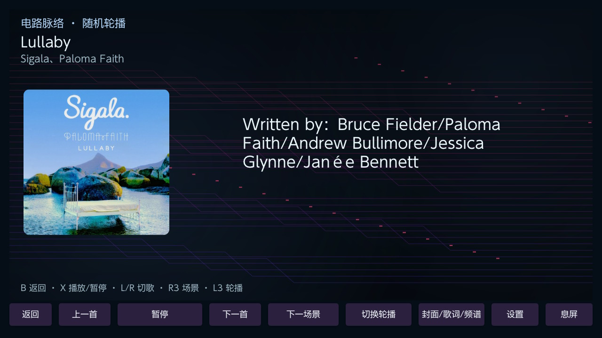
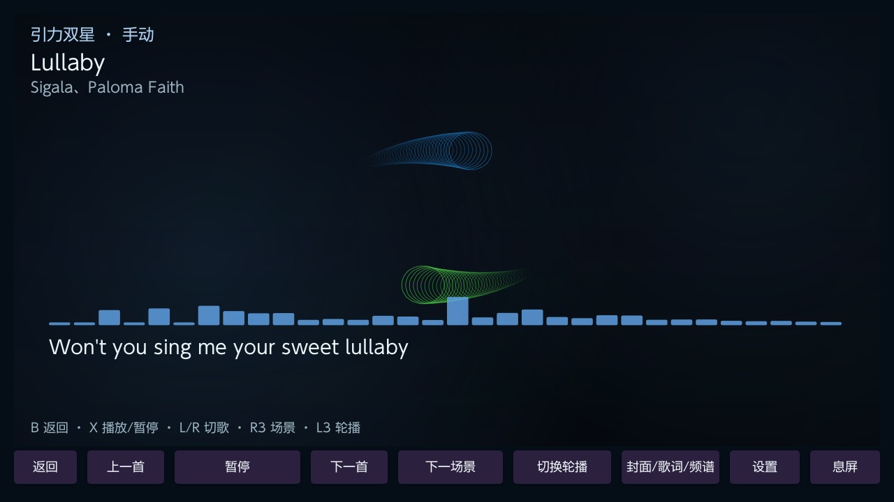
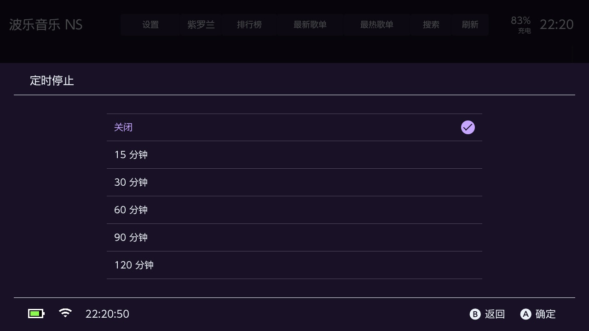
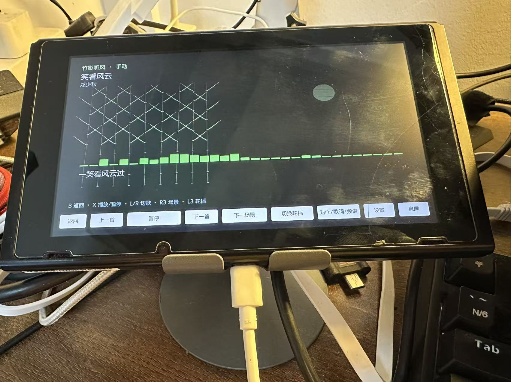
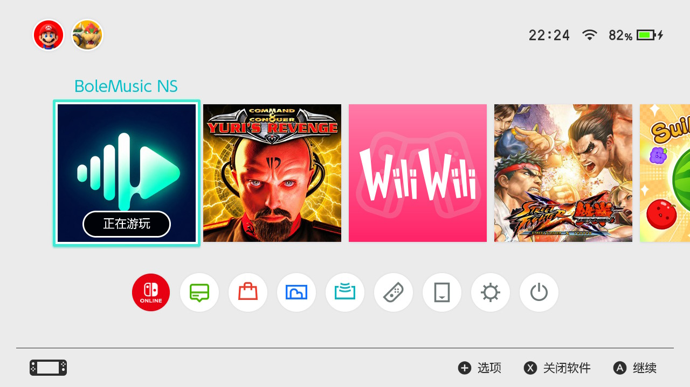

# BoleMusic NS

一款面向 Nintendo Switch 的音乐播放器，支持触屏操作、歌词显示和动态氛围，让 Switch 也能成为桌边的音乐屏。

基于 LX Music（lyswhut/lx-music-desktop）的自定义源协议与相关实现进行适配和二次开发的非官方 Switch 播放器。应用使用中性名称 BoleMusic NS，启动文件为 `bolemusic.nro`。

**本软件不内置、不提供、不推荐任何音源或曲库。首次启动的自定义源列表为空。请在设置中自行导入自定义源。**

## 下载

- [下载最新版 bolemusic.nro（GitHub）](https://github.com/shellsec/bolemusic/releases/latest/download/bolemusic.nro)
- [下载最新版 bolemusic.nro（加速入口）](https://ghfast.top/https://github.com/shellsec/bolemusic/releases/latest/download/bolemusic.nro)
- [查看版本与更新说明](https://github.com/shellsec/bolemusic/releases)

加速入口通过第三方代理访问 GitHub Release 附件；若不可用，请使用 GitHub 原始链接。只需下载 `bolemusic.nro`。Release 附件仅提供编译后的 NRO；仓库同时提供使用说明、界面截图与版权文件，不上传播放器源码。

## 播放器功能

- **触屏与手柄操作**：搜索歌曲、浏览歌单与排行榜，管理收藏、我的歌单和播放队列。
- **日常播放**：上一首／下一首、播放／暂停、播放模式、进度控制与歌词显示。
- **动态氛围**：封面、歌词、频谱等视图，支持场景轮播，也可以隐藏文字和按钮，只欣赏氛围。
- **界面与聆听**：多种主题配色、定时停止、手动息屏，适合放在桌面上听歌。
- **自定义源管理**：自行导入源、调整顺序，按需开启多源自动切换与订阅更新。

歌曲播放及在线内容需要用户导入兼容的自定义源，并取决于相应服务与网络是否可用。息屏用于关闭屏幕显示，不等于系统休眠。

## 界面预览

以下为已有版本的界面截图与实机照片，用于展示播放体验；歌曲、封面与歌词是演示内容，不随软件提供。当前版本不内置任何音源，部分按钮和提示以实际版本为准。

主页展示图经图像编辑隐去了旧音源名称，用于说明布局和主题配色。

| 主页 · 樱粉 | 主页 · 冰蓝 |
| --- | --- |
|  |  |
| 主页 · 紫罗兰 | 主页 · 浅色 |
|  |  |

| 氛围 · 封面与歌词 | 氛围 · 动态频谱 |
| --- | --- |
|  |  |
| 定时停止 | Switch 实机氛围展示 |
|  |  |



上图展示安装转发器后的主菜单入口；复制 NRO 后可直接从 Homebrew Menu 启动，主菜单入口需要另行安装转发器。

## 开始使用

将 `bolemusic.nro` 放入 SD 卡的 `/switch/` 目录，通过 Homebrew Menu 启动。首次启动后，先在设置中导入自己的自定义源，再开始播放。

进入氛围页面可点击主页播放区的歌曲封面。氛围页面支持切歌、播放／暂停和切换场景；隐藏界面后，轻触屏幕可唤回控制。

## 导入自定义源

1. 打开「设置 → 音源 → 增加 JS 音源」。
2. 输入名称及自己的本地脚本路径，或自行取得的脚本 HTTP(S) 地址。
3. 加载完成后，在音源管理中选择当前源。

本地路径使用 `sdmc:/` 格式。仅支持兼容 LX Music 自定义源协议的脚本，不保证所有脚本可用。未导入源时，搜索、歌单和排行榜只提示「请在设置中导入自定义源」，不展示推荐来源或链接。

## 多源自动切换

- 默认关闭。在「设置 → 多源自动切换」中主动开启。
- 关闭时只尝试当前选择的用户源，不转向其他源。
- 开启后，仅在用户已导入的源之间，按音源列表从上到下重试；每轮每个源最多尝试一次。
- 在音源管理中点击选择源，再用「上移／下移」调整顺序。顺序会保存，重启后保留。
- 顺序或开关的修改用于下一轮播放，避免改变正在进行的重试队列。
- 全部源失败后，仅当你填写过订阅地址才检查更新；清单或脚本内容发生变化时，按原顺序再重试一轮。没有变化、检查失败或第二轮仍失败时结束。
- 同一首歌最多自动检查一次，全局自动检查间隔至少 10 分钟；切歌会作废旧检查，不会循环请求远程。

## 订阅更新

源清单地址默认为空。用户在「设置 → 源清单地址」添加一次后会保存，重启后保留。可点击「从源清单地址更新」主动更新；开启多源自动切换后，所有已导入源失败时也会按上述限制自动检查这个地址。没有填写地址时不会请求订阅。

示例地址仅为格式说明，不是可用音源：`https://example.com/sources.json`。

清单兼容以下格式，也接受同样条目组成的顶层数组：

```json
{
  "sources": [
    { "id": "my-source", "name": "我的自定义源", "url": "https://example.com/source.js" }
  ]
}
```

清单中的 `id`、`name`、`url` 必须是有效字符串，不接受重复标识或地址。无效清单、网络失败或保存失败保留原导入配置。有效清单按 URL 合并，保留手动导入源和既有顺序，新条目追加到列表末尾。更新时也会检查清单中远程脚本的内容；下载失败会保留原脚本缓存。单次检查有 45 秒总时限，单脚本最多 2 MiB、缓存更新合计最多 8 MiB，超限或未完成的脚本保留旧缓存。手动导入源继续参与切换，不在清单中的本地或远程脚本不会被订阅改写。内容更新不保证脚本可用或播放成功。

## 使用与免责声明

本软件不提供任何音源、歌曲或版权授权。用户自行导入的内容与来源由用户自行选择和负责，请遵守当地法律、版权要求及相关服务条款，仅使用已获授权或法律允许的内容。不要向不可信脚本提供账号、密码或令牌。

第三方脚本和服务可能失效或产生网络请求；本软件不保证其安全性、准确性及持续可用性。免责声明不排除法律规定不得排除的责任。

本项目不是 LX Music、Nintendo 或音乐平台的官方产品，也不表示获得授权、合作或背书。保留上游 [Apache-2.0 LICENSE](LICENSE)、作者声明及依赖许可证；修改内容见 [NOTICE](NOTICE)。

项目地址：[shellsec/bolemusic](https://github.com/shellsec/bolemusic)
